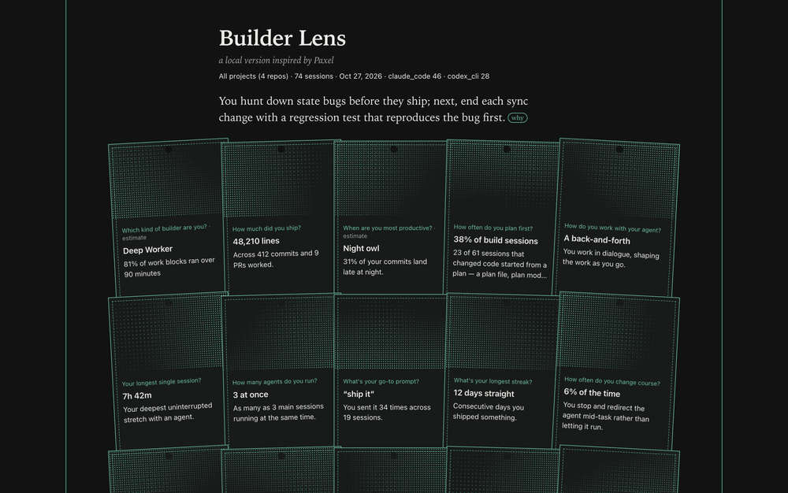
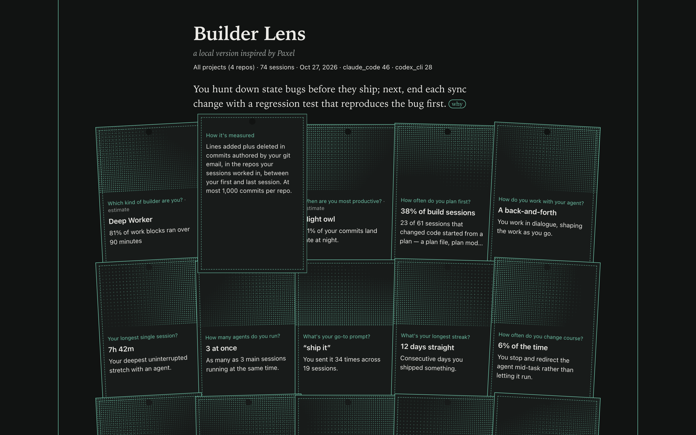
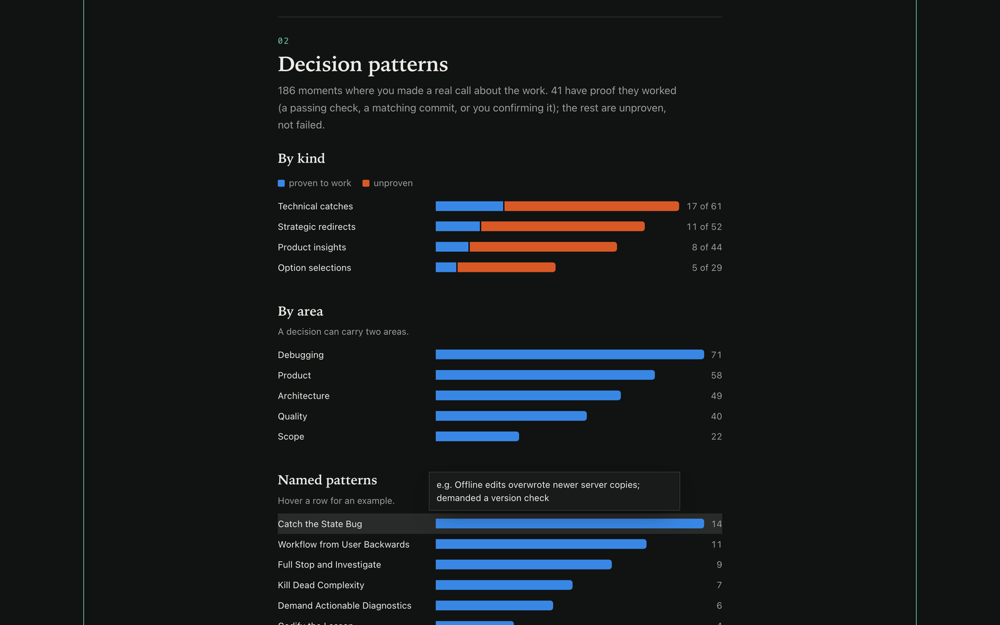
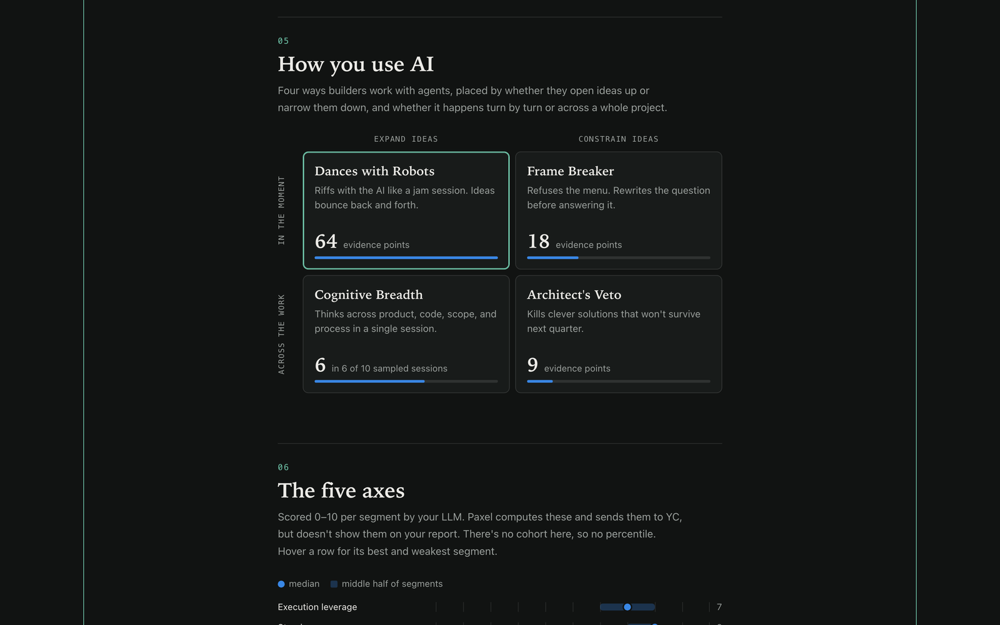
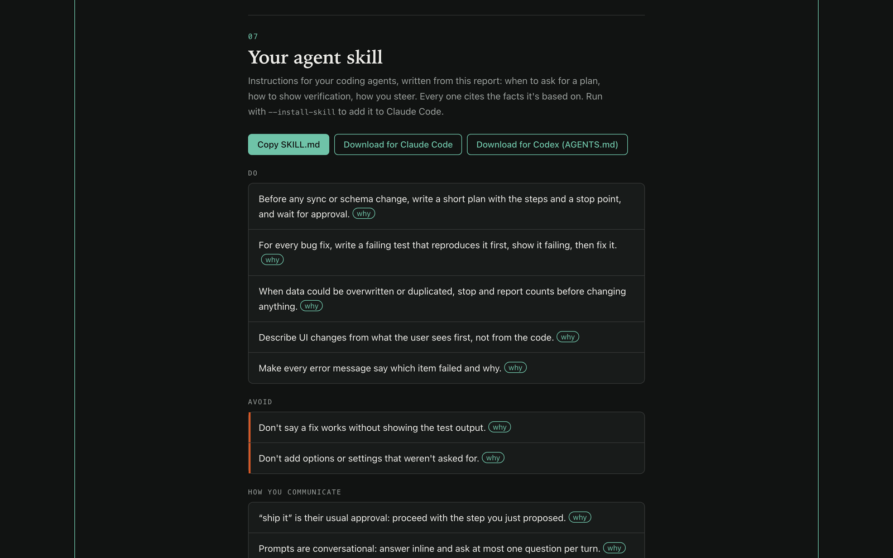

# Builder Lens

**See how you actually build with AI agents, on your own machine, with the AI you already use.**



*The GIF and screenshots use the made-up builder from `--demo`. Regenerate them with
`python3 scripts/demo_gif.py` (needs Chrome and ffmpeg).*

## Why

You spend hours a day in Claude Code and Codex. Those transcripts say a lot about how you
work: what you ship, how you steer, when you plan and when you skip it. YC's
[Paxel](https://paxel.ycombinator.com) turns them into a builder report, but you upload
them to get it ([terms](https://paxel.ycombinator.com/terms)).

Builder Lens takes a different stance: **use your data, and keep the privacy you already
have.** Your transcripts already live with the company whose agent wrote them. Builder Lens
reads them locally and runs its analysis through that same CLI (`claude` or `codex`), so the
data goes nowhere it hasn't already been. There's no account, no server and no upload.

It's a local version inspired by Paxel, worked out backwards from published Paxel reports.

## Try it

```sh
git clone https://github.com/saranyan/builder-lens.git && cd builder-lens
python3 builder_lens.py --demo     # a made-up builder: reads nothing, sends nothing
python3 builder_lens.py            # your own projects → out/report.html
```

Python 3.9+, macOS or Linux, no dependencies.

By default it uses your `claude` CLI (Haiku). To use Codex instead, pass `--llm codex`.
Both have been tested. Run with `--no-llm` for stats only, which sends nothing anywhere.

## What you get

<table>
  <tr>
    <td width="50%"><br><sub><b>Cards flip</b> to show how each number is measured.</sub></td>
    <td width="50%"><br><sub><b>Decision patterns</b>: what kinds of calls you make, and which have proof they worked.</sub></td>
  </tr>
  <tr>
    <td width="50%"><br><sub><b>How you use AI</b>: whether you expand or constrain ideas, in the moment or across the work.</sub></td>
    <td width="50%"><br><sub><b>Your agent skill</b>: instructions for your agents, built from the report.</sub></td>
  </tr>
</table>

## An agent skill, written from your own sessions

The report ends with instructions for your coding agents, based on how you actually work.
For example: "before any sync or schema change, write a short plan with a stop point and wait
for approval", or "'ship it' is their usual approval". Each instruction lists the measured
facts behind it.

```sh
python3 builder_lens.py --install-skill   # also installs it to ~/.claude/skills/builder-lens-working-style/
```

You get `out/skill/builder-lens-working-style/SKILL.md` for Claude Code and
`out/skill/AGENTS.md` to paste into Codex's `AGENTS.md`. The report also has Copy and
Download buttons. Re-run it whenever you want the skill to catch up with how you work.

## How it's different from Paxel

- **Your data stays where it already is.** Nothing is uploaded. The only model call goes
  through your own CLI, and excerpts are redacted first.
- **You see every score.** Paxel scores you on five axes (execution leverage, steering,
  engineering quality, product thinking, planning) and doesn't show them on your report.
  Builder Lens charts all five.
- **Claims come with evidence.** Every statement about you has a **why** you can hover,
  listing the measured facts behind it. If a claim can't cite a fact, or quotes a number
  the facts don't contain, it's dropped.
- **It reads meaning, not just words.** Decisions are classified from what you said *and*
  what the agent had just proposed: a redirect, a caught mistake, a product call, or a pick
  between options.
- **Cards flip.** Click any stat card to see exactly how it's measured, with your raw
  numbers.
- **Advice you can act on.** Each growth area ends with something concrete to try in your
  next session.
- **It feeds back into your agents.** The report becomes a skill file your agents load, so
  what it learns changes how they work with you.
- **Honest outcomes.** A decision only counts as having worked when there's proof, such as
  a passing check, a matching commit or you confirming it. "Unproven" isn't treated as
  failure.
- **Automated runs don't count.** Headless `claude -p`, SDK, `codex exec` and sub-agent
  runs are left out, so the report is about you.

## Options

```sh
python3 builder_lens.py --project my-app         # one repo
python3 builder_lens.py --llm codex --workers 6  # Codex, 6 calls at a time
python3 builder_lens.py --model sonnet           # a bigger Claude model
python3 builder_lens.py --include-automated      # count headless runs too
```

## Good to know

- It reads `~/.claude/projects` and `~/.codex/sessions` and runs read-only `git` in the
  repos those sessions touched.
- Before anything reaches the model, keys, tokens, emails, phone numbers and your home path
  are scrubbed. The CLI runs with no tools and doesn't save a session.
- Results are cached in `~/.cache/builder-lens`. The first run on about 50 sessions takes
  about 4 minutes with Haiku. Later runs take seconds.
- The report is a single HTML file with no web fonts, images or scripts from anywhere else.
  Opening it makes no network requests.
- Cards marked *estimate* use thresholds that are still guesses.
  [REPORT_SPEC.md](REPORT_SPEC.md) shows what was reverse-engineered and how confident we are.
- `out/` holds your data. It's gitignored, so don't commit it.
- Not affiliated with Y Combinator or Paxel.

## Tests

```sh
python3 -m unittest discover -s tests
```

[Report spec](REPORT_SPEC.md) · [MIT license](LICENSE)
